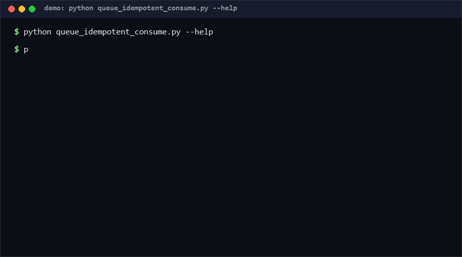

# queue-idempotent-consume

At-least-once delivery is the default in every real queue, so consumers must deduplicate. This tool makes the dedup contract explicit and testable: lint a consumer's dedup-key/store/TTL declaration, then replay a real delivery log with duplicates injected and verify that effects happened exactly once per key. Catches the classic "handler ran twice" bug before production does. Pure Python, standard library only.

As of 2026-10-13, no direct equivalent found as of 2026-10-13: idempotency-key specs exist as API conventions, but searches across GitHub (194 queries) and the web found no standalone duplicate-delivery simulator plus declaration linter.

<p align="center"></p>

## Problem

Brokers redeliver. Consumers crash after side effects but before acks. Retries multiply deliveries. Every team learns this the hard way: a charge applied twice, an email sent twice. The consumer *should* have declared a dedup key and a store — but nothing forces that declaration to exist, be complete, or actually work under redelivery until an incident proves it doesn't.

## How it works

1. **Declaration linter (`lint`).** A consumer spec `{dedup_key, store, ttl_seconds, at_least_once}` is checked: missing dedup key (`S001`, fail), no store (`S002`, fail), missing TTL / unbounded growth (`S003`, warn), non-positive TTL (`S004`, fail).
2. **Dedup engine.** `IdempotentConsumer` + `MemoryStore` implement at-most-once per key with optional TTL and eviction counting. Keys resolve via dotted paths (`payload.order_id`); typed keys (`1` vs `"1"` vs `true`) never collide.
3. **Redelivery simulator (`simulate`).** Replays a JSONL delivery log; after every Nth processed message the same message is re-delivered M times (`--dup-every/--dup-count`). The report states `processed`, `duplicates_suppressed`, `no_key`, and `exactly_once` (true iff every keyed message processed once and nothing was keyless).
4. **Log checker.** Static findings over the same log: missing keys (`Q001`), same key with different payload (`Q002`, fail), benign replays (`Q003`), non-monotonic `seq` (`Q004`).

## Quickstart

Requires Python 3.8+. No dependencies, no broker, no network. Simulating 20,000 deliveries takes ~0.04 s [Measured].

```bash
# 1) lint the consumer declaration
python queue_idempotent_consume.py lint --spec consumer.json

# 2) replay a real delivery log with duplicates every 5th message
python queue_idempotent_consume.py simulate --log deliveries.jsonl --dup-every 5 --dup-count 2 --json
```

Log format: one JSON object per line, e.g. `{"seq": 1, "id": "m1", "key": "order-42", "payload": {...}}`.

## Why not X

- **Broker-side dedup (Kafka transactions, SQS FIFO dedup keys)**: moves the guarantee into the infra and locks you to that broker; this tool tests the *consumer* contract offline and broker-agnostically. No direct equivalent found as of 2026-10-13 for a standalone simulator.
- **Idempotency-key HTTP specs** (Stripe-style headers): a naming convention for requests; no executable duplicate-injection test and no consumer-side TTL/store linting.
- **Property-based testers (hypothesis)**: can generate duplicates but know nothing about delivery semantics; you would rebuild this simulator inside the test each time.
- **Integration test suites against a real broker**: slow, stateful, flaky; this replays a captured log deterministically in milliseconds.

## Performance

Measured on Windows 10, Python 3.13, single core:

| Workload | Time | Reproduce |
|---|---|---|
| 20,000-message log, dup every 5th [Measured] | 0.040 s | `python -c "import time,queue_idempotent_consume as q; e=[{'key':'k%d'%(i%500)} for i in range(20000)]; s=time.perf_counter(); q.simulate(e,dup_every=5); print('%.4fs'%(time.perf_counter()-s))"` |
| declaration lint [Measured] | < 0.01 s | `python queue_idempotent_consume.py lint --spec consumer.json` |

## Minimal Fallback

No Python? In a spreadsheet or notebook: sort the log by key and flag rows where the key appeared before (`COUNTIF($A$1:A1, A2)>1`). That approximates `duplicates_suppressed`; it cannot test TTL expiry, key-type collisions, or the exactly-once effect count.

## Design Trade-offs

- **In-memory store only.** Real deployments use Redis/SQL; the simulator's job is contract verification, not persistence. TTL semantics are modelled, storage engines are not.
- **Key = dotted path into JSON.** Covers the common case; computed keys (hashes of payload) must be precomputed into the log.
- **`exactly_once` requires zero keyless messages.** Strict by design — a dropped (keyless) message is a silent effect; better to fail the report than hide it.
- **Replay, not live tailing.** Captured logs keep the tool side-effect free; live-consumer integration is a different (riskier) product.

## Limits & Second-order Effects

- TTL is time-based on replay; a TTL shorter than your replay duration can show false "processed twice" — size TTLs above redelivery windows.
- Passing the simulator does not prove the production handler is atomic; side effects outside the dedup store (email, payment) still need transactional guards.
- A same-key-different-payload finding (`Q002`) often reveals a key-scheme bug — investigate before "fixing" the test data.
- Teams may add dedup keys mechanically without reviewing blast radius; the linter checks structure, not key quality.

## FAQ

**When NOT to use this?** Not as a production dedup service, not for exactly-once *stream processing* semantics (use transactions/windowing there), and not to replace broker-level ordering guarantees.

**Does it connect to a queue?** Never. Input is a JSONL capture file; output is a report.

**Why does a missing key fail the run?** A keyless message can never be deduplicated, so exactly-once is unprovable for it.

**Can keys be non-strings?** Yes — numbers, bools and strings are type-tagged internally so `1`, `"1"` and `true` stay distinct.

## [Core Assumptions]

- **At-least-once delivery is the operative reality** for the target systems. Confidence: high — that is the industry default.
- **A single dedup key per message suffices** for the modelled consumers. Confidence: medium-high — multi-key semantics are out of scope.
- **Captured logs are representative** of redelivery patterns. Confidence: medium — injection parameters (`--dup-every`) are configurable for a reason.
- **Handler effects are counted, not verified externally.** Confidence: high within the simulator's scope.

As of 2026-10-13.

---

Part of the [zhengming-toolbox](https://github.com/chenhz01/zhengming-toolbox) — 105 purpose-built AI-engineering tools across neglected niches.

Related tools: [pagination-integrity-check](https://github.com/chenhz01/pagination-integrity-check) · [uniqueness-precheck](https://github.com/chenhz01/uniqueness-precheck) · [primary-key-guard](https://github.com/chenhz01/primary-key-guard)
